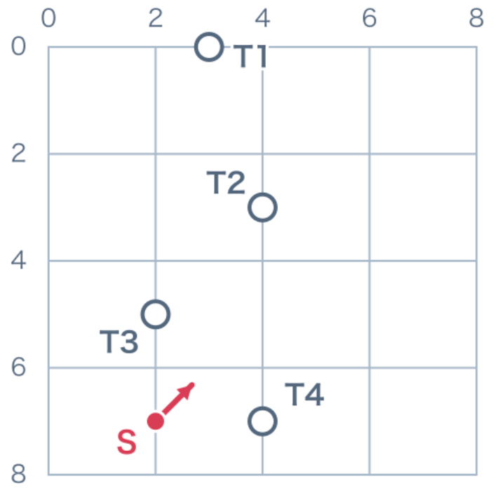
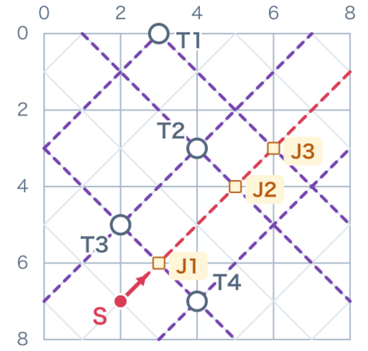
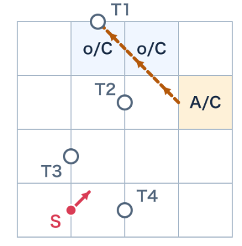
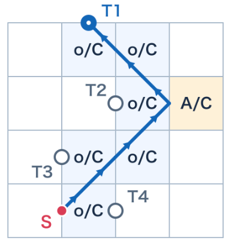
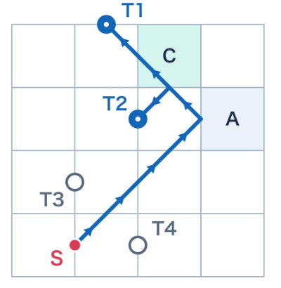
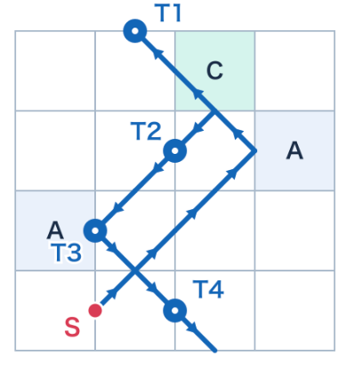
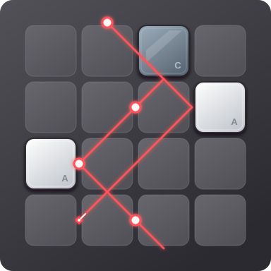

# Lazor Solver

Read a `.bff` puzzle, find block placements that make the laser reach every target, and export the final board and light paths. The integrated solver requires Python 3.9 or newer and uses only the standard library.

## Algorithm

### 1. Read the Initial Board



Read the board, sources, targets, and block inventory from the `.bff` file. S marks the source, its arrow shows the initial direction, and T1–T4 are the targets. Each cell has a side length of 2, with the coordinate origin at the top left.

### 2. Build the Targets' X Candidate Lines



Lasers travel at 45 degrees, so each target has two candidate lines with slopes `+1` and `-1`, forming an X. Purple dashed lines show these candidates. J1, J2, and J3 are their intersections with the source's initial direction extended across the board, marking possible turns.

Candidate lines represent possible arrival directions. Search works backward from an unconnected target toward the source or an already established light path. Intermediate segments can also follow lines that do not pass through a target.

### 3. Determine Blocks with R/T

Each block has two 0/1 switches: `R` controls reflection and `T` controls transmission. `1` enables a behavior; `0` disables it.

| Type | R (reflection) | T (transmission) | Light behavior |
| --- | :---: | :---: | --- |
| Empty `o` / no-placement empty cell `x` | 0 | 1 | Continue straight |
| A reflector | 1 | 0 | Reflect |
| B opaque block | 0 | 0 | Absorb |
| C splitter | 1 | 1 | Continue straight and reflect |

Transmission follows the original line. Reflection produces a ray through the contact point with slope `-m` instead of `m`; its forward direction depends on which block edge is hit.

Route choices become requirements on each cell. For a cell that permits block placement:

| Route requirement | R requirement | T requirement | Allowed candidates |
| --- | :---: | :---: | --- |
| Straight travel required | Unrestricted | 1 | Empty `o` or C |
| Reflection required | 1 | Unrestricted | A or C |
| Both required in the same cell | 1 | 1 | C only |

Unrestricted does not mean `0`. A route requiring straight travel only requires `T=1`, so C can still produce an additional reflected ray. Candidates must also satisfy the original board and inventory constraints.

The Mad 1 example below illustrates one sequence of choices. Arrows show forward light travel, while search works backward from targets. Row and column numbers start at 1, and `o` means empty.

**Try a reflection**



Search backward along a candidate direction from T1 and try turning at J3. Row 2, column 4 requires `R=1`, leaving A or C as candidates. This route has not yet been connected to the source.

**Connect T1**



Continue back to S to establish a complete path to T1. Cells crossed by straight segments require `T=1`, allowing empty or C. The reflecting cell still allows A or C.

**Determine C and A**



Connecting T2 requires row 1, column 3 to both reflect and transmit, so it must be C. Once the only C is used, row 2, column 4 must be A.

**Reach every target**



Place the second A in row 3, column 1. The path reaches T3 and turns toward T4. Once every target is connected, the simulator checks the final layout.

### 4. Prune, Backtrack, and Verify

Each chosen segment adds R/T requirements to its cells and triggers an inventory check: confirmed blocks must not exceed the supply, and enough positions must remain for the required blocks. On conflict, backtrack and try another direction. Reflection costs guide search order. A block can be hit repeatedly, so the block count is not a direct limit on reflections.

This method searches for target paths and progressively narrows block choices, reducing the need to enumerate complete layouts. After connecting every target, assign the remaining blocks and replay the full light paths with the simulator. Stop at the first verified solution.

## Run and Outputs

From the project directory:

```bash
python3 -B main.py examples/mad_1.bff
```

The default Target-X algorithm has a 60-second search budget per puzzle. Add `--algorithm dfs` to use baseline placement enumeration for comparison.

**Every successfully solved puzzle automatically generates a result image**, saved by default as `results/<puzzle_name>/solution.svg`. Batch runs produce a separate image for each solved puzzle. Below is the Mad 1 output: red lines show laser paths, and glowing dots mark targets that were hit.



For example, the Mad 1 image is saved as `results/mad_1/solution.svg`. The same directory contains:

| File | Contents |
| --- | --- |
| `solution.svg` | Final blocks and light paths |
| `solution.txt` | Board, block positions, and light-path details |
| `solution.bff` | Reloadable final layout |
| `search_status.txt` | Status, elapsed time, and search statistics |

A run that finds no solution or times out writes a status report without generating a new solution. Timeout does not prove that the puzzle has no solution.

## Levels and Tests

The [level dataset](data/lazor_level_collection.zip) contains 157 primary A/B/C puzzles, four source variants, and raw data for 52 unsupported prism levels. It comes from public collections by [halghm4](https://github.com/halghm4/lazor_solver/tree/8aef93e9ce75bcdd5d1f5cb626cdacb71006cbe7/boards/all) and [electricg](https://github.com/electricg/laser-game-canvas/blob/63299ad451b4d739a1e9f35fae68f7c184e7fa8f/levels.js), and is not confirmed as the game's complete official level set.

```bash
python3 -m zipfile -e data/lazor_level_collection.zip data
python3 -B main.py data/lazor_level_collection/levels/*/*.bff --timeout 120 --output-dir results/public_levels
python3 -B -m unittest discover -s tests -v
```

All 26 unit tests pass. All 157 primary puzzles were solved, independently checked, and verified again after exporting and reloading their BFFs. Total reading and solving time was about 0.34 seconds, excluding startup, imports, independent checks, and output writing. Large synthetic stress cases remain a limitation, with timeouts in earlier tests. [Full test records and results](data/public_levels_157_results.zip)

## Team Contributions

| Contributor | Work |
| --- | --- |
| fangyu li | File parsing, block placement, and result output |
| Xingjian Yang | Block classes and laser simulation; participation in basic DFS, SMT constraint solving, source-unreachable-state pruning, and related explanations and integration notes |
| weibo zhao | X-line/R/T search design, search optimization and pruning, inventory constraints and rollback, integration and testing |

These are the main contributions. Search implementation and pruning include shared and overlapping work.

Original teammate submissions are retained in [Fangyu/](Fangyu/) and [Xingjian/](Xingjian/). The project root contains the integrated program.

- fangyu li: [file parsing](Fangyu/file_io.py), [block placement](Fangyu/search.py), and [result output](Fangyu/output.py).
- Xingjian Yang: [block classes and laser simulation](Xingjian/block_laser.py). He also contributed to [basic DFS](Xingjian/search.py), [SMT constraint solving](Xingjian/constraint_solver.py), [source-unreachable-state pruning (line 300)](Xingjian/constraint_solver.py#L300), [mathematical model and pruning principles](Xingjian/MATH_MODEL.txt), and [installation, running, and integration notes](Xingjian/README.txt). The SMT comparison program requires Z3; see [requirements.txt](Xingjian/requirements.txt).

The main search implementation is in [target_solver.py](target_solver.py), [constraints.py](constraints.py), and [search_graph.py](search_graph.py). Implementation and documentation used Codex assistance.
