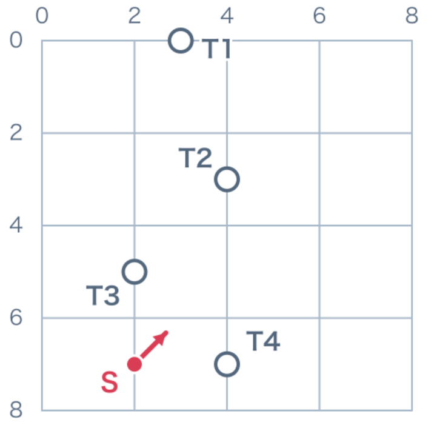
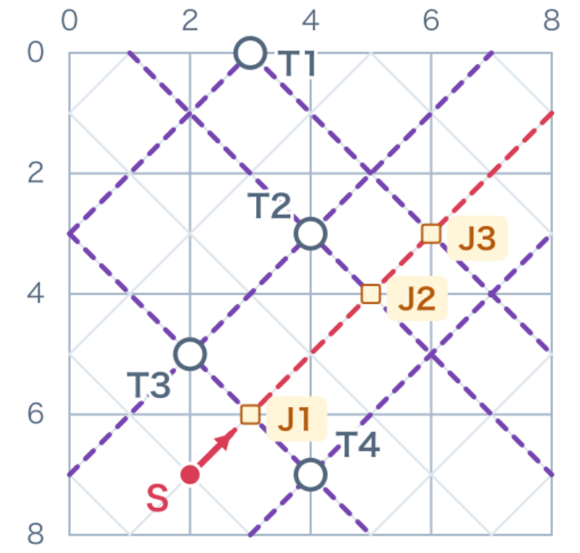
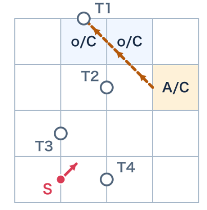
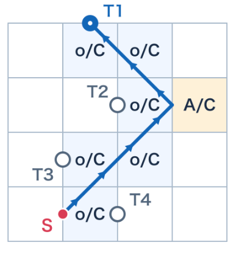
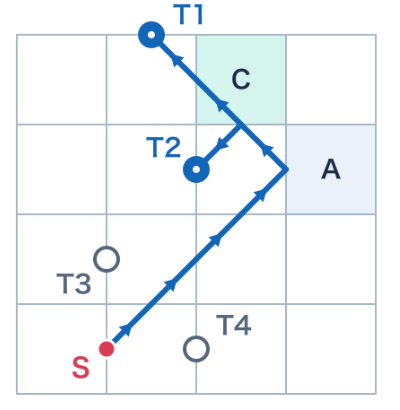
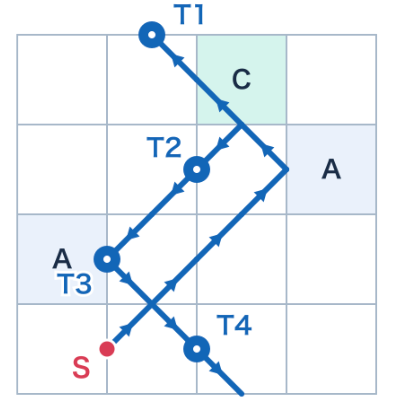
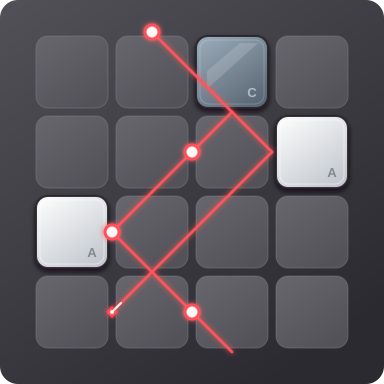

# Lazor 求解器

读取 `.bff` 关卡，寻找方块摆放方案，使激光经过全部目标，并输出最终棋盘和光路。使用 Python 3.9 或更新版本，只依赖标准库。

## 算法思路

### 1. 读取初始棋盘



读取 `.bff` 中的棋盘、光源、目标和方块库存。图中 S 是光源，箭头表示初始方向，T1–T4 是需要经过的目标。每格边长记为 2，坐标原点在左上角。

### 2. 建立目标的 X 候选线



激光沿 45° 方向传播，因此每个目标都有两条斜率为 `+1` 和 `-1` 的候选线，形成一个 X。紫色虚线表示候选方向；J1、J2、J3 是它们与光源初始方向延长线的交点，表示可以考虑的转弯位置。

候选线只表示可能的到达方向。程序从尚未接通的目标反向找路，尝试接到光源或已经确定的光路；中途也可以经过不穿过目标的线段。

### 3. 用 R/T 决定方块

每种方块都可以用两个 0/1 开关表示：`R` 控制反射，`T` 控制透射。`1` 表示开启，`0` 表示关闭。

| 类型 | R（反射） | T（透射） | 光线行为 |
| --- | :---: | :---: | --- |
| 空位 `o` / 禁放空位 `x` | 0 | 1 | 继续直行 |
| A 反射块 | 1 | 0 | 反射 |
| B 不透明块 | 0 | 0 | 吸收 |
| C 分裂块 | 1 | 1 | 同时直行和反射 |

直行保持原来的直线；反射产生一条经过碰撞点、斜率由 `m` 变为 `-m` 的光线，前进方向由碰到的方块边决定。

搜索选择光路时，就把路径要求转换成方块候选。对于可摆放格：

| 路径要求 | 对 R 的要求 | 对 T 的要求 | 允许的方块候选 |
| --- | :---: | :---: | --- |
| 需要直行 | 未限制 | 1 | 空位 `o` 或 C |
| 需要反射 | 1 | 未限制 | A 或 C |
| 同一格同时需要直行和反射 | 1 | 1 | 只能是 C |

“未限制”不等于 `0`。例如，需要直行时只要求 `T=1`，仍允许使用同时产生反射光的 C。候选还要满足原有棋盘与库存约束。

下面用 Mad 1 展示一次选择过程。图中箭头表示实际光的传播方向，搜索则从目标反向找路。行列从 1 开始编号，`o` 表示空位。

**尝试反射**



从 T1 的候选方向反向找路，在 J3 尝试转弯。第 2 行第 4 列需要 `R=1`，候选缩小到 A 或 C；这时路线还没有接回光源。

**接通 T1**



继续接回 S，形成到达 T1 的完整路径。沿途直行的格子需要 `T=1`，可以是空位或 C；反射格暂时仍可选 A 或 C。

**确定 C 和 A**



为接通 T2，第 1 行第 3 列同时需要反射和透射，因此确定为 C。唯一的 C 用完后，第 2 行第 4 列就只能放 A。

**命中全部目标**



第 3 行第 1 列放第二块 A，光路经过 T3 后转向 T4。全部目标接通，再由模拟器验证最终摆法。

### 4. 剪枝、回滚与验证

每选一段光路，就合并它对格子的 R/T 要求，并检查方块库存：已确定的数量不能超额，剩余位置也必须放得下所需方块。出现冲突就回退，尝试其他方向。反射代价用于安排搜索顺序；同一块可以被多次碰到，因此方块数不能直接当成反射次数上限。

相比先枚举整盘摆法再模拟，这种方法先为目标寻找路径，再逐步收紧方块选择。所有目标接通后，补齐剩余方块，并用激光模拟器验证完整光路，找到一个有效解就结束。

## 运行与输出

在项目目录运行：

```bash
python3 -B main.py examples/mad_1.bff
```

默认使用目标 X 算法，每关搜索预算为 60 秒。添加 `--algorithm dfs` 可使用基础枚举算法进行对照。

**每成功解出一关，程序会自动生成一张结果图**，默认保存为 `results/关卡名/solution.svg`。批量运行时，每关分别生成自己的结果图。下面是运行 Mad 1 后的输出，红线表示激光路径，发光圆点表示已命中的目标。



例如，Mad 1 的结果图保存为 `results/mad_1/solution.svg`。同一目录还包含以下文件：

| 文件 | 内容 |
| --- | --- |
| `solution.svg` | 最终方块与光路图 |
| `solution.txt` | 棋盘、方块位置与光路详情 |
| `solution.bff` | 可重新读入的最终摆法 |
| `search_status.txt` | 求解状态、耗时与搜索统计 |

未找到解或超时时，只生成本次状态报告；超时不代表无解。

## 关卡与测试

[关卡数据包](data/lazor_level_collection.zip)包含 157 个 A/B/C 主关卡、4 个来源变体，以及 52 个暂不支持的棱镜关卡原始数据。来源为 [halghm4](https://github.com/halghm4/lazor_solver/tree/8aef93e9ce75bcdd5d1f5cb626cdacb71006cbe7/boards/all) 和 [electricg](https://github.com/electricg/laser-game-canvas/blob/63299ad451b4d739a1e9f35fae68f7c184e7fa8f/levels.js) 的公开整理，不能视为游戏的官方完整关卡集。

```bash
python3 -m zipfile -e data/lazor_level_collection.zip data
python3 -B main.py data/lazor_level_collection/levels/*/*.bff --timeout 120 --output-dir results/public_levels
python3 -B -m unittest discover -s tests -v
```

当前 26 项单元测试通过，157 个主关卡全部解出，并通过独立光路检查和导出 BFF 回读验证。该批次累计读取与求解约 0.34 秒，不含启动、导入、独立检查和输出时间；大型合成压力关仍有超时情况。[完整测试记录与结果](data/public_levels_157_results.zip)

## 合作贡献

| 负责人 | 工作 |
| --- | --- |
| fangyu li | 文件读取、方块摆放和结果输出 |
| Xingjian Yang | 方块类和激光模拟；参与基础 DFS 搜索、SMT 数学约束求解、光源不可达状态剪枝，以及相关原理与合并说明 |
| weibo zhao | X 候选线与 R/T 搜索设计、搜索优化与剪枝、库存约束和回滚、合并与测试 |

以上列出各自的主要贡献，搜索实现与剪枝部分存在共同参与和重合。

两位组员提供的原始版本分别保存在 [Fangyu/](Fangyu/) 和 [Xingjian/](Xingjian/)，根目录为合并后的程序。

- fangyu li：[文件读取](Fangyu/file_io.py)、[方块摆放](Fangyu/search.py)、[结果输出](Fangyu/output.py)。
- Xingjian Yang：[方块类与激光模拟](Xingjian/block_laser.py)；参与的算法与说明见 [基础 DFS 搜索](Xingjian/search.py)、[SMT 数学约束求解](Xingjian/constraint_solver.py)、[不可达状态剪枝（第 300 行）](Xingjian/constraint_solver.py#L300)、[数学模型与剪枝原理](Xingjian/MATH_MODEL.txt)、[安装、运行与合并说明](Xingjian/README.txt)。其中 SMT 对照程序需要 Z3，依赖见 [requirements.txt](Xingjian/requirements.txt)。

搜索部分主要看 [target_solver.py](target_solver.py)、[constraints.py](constraints.py) 和 [search_graph.py](search_graph.py)。实现与整理过程中使用了 Codex 辅助。
